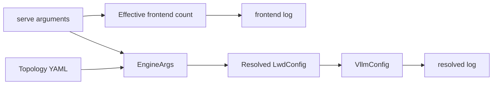

# LWD startup configuration logging

Set `VLLM_LWD_LOG_LEVEL=INFO` before starting each edge or cloud process.
The default is `DISABLE`; `VLLM_LOGGING_LEVEL` does not control LWD logs.
All configuration records use `vllm.lwd_logger.lwd_logger`, which adds `[lwd]`.



`[config] frontend=` records the effective API frontend count, role, instance ID,
RPC endpoint and attachment endpoint. It runs after frontend count adjustments
and before dispatch can replace a count of one with `None`. The count describes
the local serve frontend launch; it is not inferred from topology instance counts.
Non-LWD launches do not emit this record.

`[config] resolved=` records the parsed configuration snapshot, including:

- Configuration path, role and instance ID.
- Deployment, feature flags, all edge/cloud instances, DP ranks and ports, and links.
- API RPC and attachment endpoint metadata.
- Coordination settings, selected instance, selected connections and cloud card counts.

Defaults are included. The snapshot is serialized without reopening the YAML or
reading tenant key contents. Serialization is skipped when INFO logging is disabled.
The record describes parsed LWD metadata, not confirmation that connections are live.
Each `VllmConfig` initialization can emit a snapshot; there is no global suppression
across processes or independently constructed configurations.

Use the parser field names `scene` and `enable_early_recv` in YAML.

Run the focused configuration logging and entry tests in the project environment:

```bash
uv run --no-sync python -m pytest --confcutdir=tests/config/lwd tests/config/lwd/test_logging.py tests/config/lwd/test_entry.py -q
```
