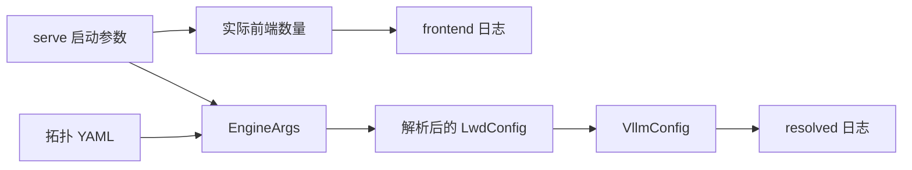

# LWD 启动配置日志

启动每个边端或云端进程前，设置 `VLLM_LWD_LOG_LEVEL=INFO`。
默认值为 `DISABLE`；`VLLM_LOGGING_LEVEL` 不控制 LWD 日志。
所有配置日志都使用 `vllm.lwd_logger.lwd_logger`，由它统一添加 `[lwd]` 前缀。



`[config] frontend=` 记录实际 API 前端数量、角色、实例 ID、RPC 地址和 attach 地址。
打印时机在前端数量调整完成之后、启动分支可能将数量 1 改为 `None` 之前。
该数量表示本地 serve 准备启动的 API 前端数量，不根据拓扑中的实例数量推算。
非 LWD 启动不会输出这条日志。

`[config] resolved=` 记录解析后的配置快照，包括：

- 配置文件路径、角色和实例 ID。
- 部署信息、特性开关、全部边端和云端实例、DP rank、端口及连接关系。
- API RPC 地址和 attach 地址信息。
- 协调配置、当前选中的实例与连接，以及各云端实例的卡数。

快照包含默认值。序列化时不会重新打开 YAML 文件，也不会读取租户密钥内容。
关闭 INFO 日志时，会跳过快照序列化。
日志描述的是解析后的 LWD 配置信息，并不表示连接已经建立。
每次初始化 `VllmConfig` 都可能输出一份快照；不同进程或独立构造的配置之间不做全局去重。

YAML 中应使用解析器支持的字段名 `scene` 和 `enable_early_recv`。

在项目环境中运行配置日志和配置入口的相关测试：

```bash
uv run --no-sync python -m pytest --confcutdir=tests/config/lwd tests/config/lwd/test_logging.py tests/config/lwd/test_entry.py -q
```
